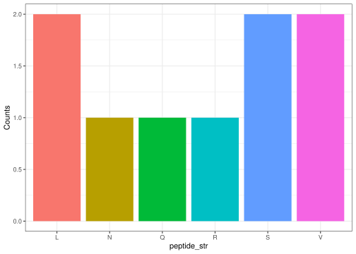

<!-- README.md is generated from README.Rmd. Please edit that file -->

# dawgma

<!-- badges: start -->
<!-- badges: end -->

The goal of dawgma is to …

## Installation

You can install the development version of dawgma from
[GitHub](https://github.com/) with:

``` r
# install.packages("pak")
pak::pak("rforbiodatascience26/group_18_package")
```

``` r
library(dawgma)
```

------------------------------------------------------------------------

link to gitHub:
<https://github.com/rforbiodatascience26/group_18_package/tree/master>

DNA_create() makes a random DNA string and takes the DNA string length
as an argument.

``` r
DNA_str <- DNA_create(27)
DNA_str
#> [1] "GTCGTCCTGCTGTCATCGCAGAATCGG"
```

DNA_to_RNA() takes a string of DNA and transforms it to RNA

``` r
RNA_str <- DNA_to_RNA(DNA_str)
RNA_str
#> [1] "GUCGUCCUGCUGUCAUCGCAGAAUCGG"
```

codon() takes an string and splits it up in codons.

``` r
codon_vector <- codon(RNA_str)
codon_vector
#> [1] "GUC" "GUC" "CUG" "CUG" "UCA" "UCG" "CAG" "AAU" "CGG"
```

translate_codons() takes a vector of codon strings and translates it to
amino acids. It returns a string of amino acids.

``` r
aminoacids <- translate_codons(codon_vector)
aminoacids
#> [1] "VVLLSSQNR"
```

plot_aa() takes a string of aminoacids and plots their frequency in the
string.

``` r
plot_aa(aminoacids)
```


